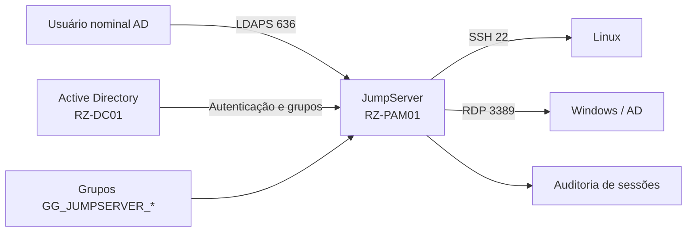

# JumpServer - PAM do LAB RZC

## 1. Objetivo

Implementar um ponto central de acesso privilegiado ao LAB RZC usando **JumpServer Community Edition**, com autenticação integrada ao Active Directory, segregação de acesso por grupos, conexão centralizada a ativos Linux e Windows e auditoria de sessões.

> Este repositório é público. **Nenhuma senha, chave privada, token ou segredo deve ser armazenado aqui.**

---

## 2. Estado atual

Última consolidação: **17/11/2026**

| Item | Status |
|---|---|
| JumpServer CE 4.10.19 | ✅ Operacional |
| Integração AD/LDAP | ✅ Operacional |
| LDAPS TCP/636 | ✅ Operacional |
| Autenticação de usuários do AD | ✅ Validada |
| Sincronização restrita por grupo AD | ✅ Validada |
| Acesso Linux via SSH | ✅ Validado |
| Acesso Windows via RDP | ✅ Validado |
| Contas administrativas individuais | ✅ Validado |
| Auditoria de sessões | ✅ Validada |
| Rotação automática de senha | ⏳ Pendente / limitação da CE |
| Password checkout / break-glass | ⏳ Pendente |
| HTTPS na interface web | ⏳ Pendente |
| MFA | ⏳ Pendente |
| Backup da plataforma | ⏳ Pendente |
| Monitoramento | ⏳ Pendente |

---

## 3. Arquitetura



### Fluxo de acesso

1. O usuário autentica no JumpServer com sua **conta nominal do AD**.
2. O acesso ao JumpServer é controlado pelos grupos `GG_JUMPSERVER_*`.
3. O JumpServer apresenta somente os ativos autorizados.
4. Para servidores Windows, cada administrador usa sua **própria conta administrativa `hol.admNNNN`**.
5. A sessão RDP/SSH é registrada pelo JumpServer.

---

## 4. Inventário

| Componente | Hostname | IP | Plataforma | Função |
|---|---|---:|---|---|
| JumpServer | `RZ-PAM01` | `172.16.240.221` | Rocky Linux 9.8 | PAM / Bastion |
| Active Directory | `RZ-DC01` | `172.16.240.201` | Windows Server | AD DS / DNS / LDAPS |

Domínio:

```text
rzc-lab.corp
```

JumpServer:

```text
Versão: 4.10.19 CE
Diretório do instalador: /opt/jumpserver-installer-v4.10.19
```

Comandos operacionais:

```bash
cd /opt/jumpserver-installer-v4.10.19

./jmsctl.sh status
./jmsctl.sh restart
```

Serviços principais:

```text
jms_core
jms_celery
jms_chen
jms_koko
jms_lion
jms_postgresql
jms_redis
jms_web
```

---

## 5. Integração com Active Directory

### 5.1 Conta de serviço LDAP

Conta dedicada:

```text
svc_jumpserver_ldap
```

DN:

```text
CN=svc_jumpserver_ldap,OU=05-ContasServico,OU=RZC,DC=rzc-lab,DC=corp
```

### 5.2 LDAPS

Servidor configurado no JumpServer:

```text
ldaps://RZ-DC01.rzc-lab.corp:636
```

A comunicação LDAPS foi validada com sucesso.

O DC utiliza certificado com Server Authentication para o endpoint LDAPS. No LAB, o certificado atual é autoassinado.

> Para produção, utilizar cadeia de confiança adequada e certificado emitido por CA corporativa ou pública conforme o desenho da organização.

### 5.3 Trust do certificado no RZ-PAM01

Exemplo do processo utilizado no LAB:

```bash
mkdir -p /opt/jumpserver/config/certs

openssl s_client \
  -connect RZ-DC01.rzc-lab.corp:636 \
  -showcerts </dev/null 2>/dev/null |
sed -n '/-----BEGIN CERTIFICATE-----/,/-----END CERTIFICATE-----/p' \
  > /opt/jumpserver/config/certs/ldap_ca.pem

cp /opt/jumpserver/config/certs/ldap_ca.pem \
  /etc/pki/ca-trust/source/anchors/RZ-DC01-LDAPS.pem

update-ca-trust
```

Validação:

```bash
openssl x509 \
  -in /opt/jumpserver/config/certs/ldap_ca.pem \
  -noout -subject -issuer -dates
```

> Durante troubleshooting foi usado `LDAPTLS_REQCERT=never` somente para diagnóstico. Não tratar isso como configuração definitiva.

---

## 6. Escopo de usuários no LDAP

OU base dos usuários:

```text
OU=01-Usuarios,OU=RZC,DC=rzc-lab,DC=corp
```

Mapeamento:

```json
{
  "username": "sAMAccountName",
  "name": "cn",
  "email": "mail",
  "groups": "memberOf"
}
```

### Restrição por grupo

Estrutura dos grupos:

```text
OU=JUMPSERVER,OU=Global,OU=04-Grupos,OU=RZC,DC=rzc-lab,DC=corp
```

Grupos:

```text
GG_JUMPSERVER_ACESSO
GG_JUMPSERVER_AWS
GG_JUMPSERVER_DATA-BASE
GG_JUMPSERVER_LINUX
GG_JUMPSERVER_NETWORK
GG_JUMPSERVER_WINDOWS
```

Para permitir grupos aninhados do Active Directory foi usada a matching rule:

```text
1.2.840.113556.1.4.1941
```

Exemplo de filtro:

```text
(&(sAMAccountName=%(user)s)(memberOf:1.2.840.113556.1.4.1941:=CN=GG_JUMPSERVER_ACESSO,OU=JUMPSERVER,OU=Global,OU=04-Grupos,OU=RZC,DC=rzc-lab,DC=corp))
```

O grupo `GG_TI_INFRAESTRUTURA` foi aninhado em `GG_JUMPSERVER_ACESSO`.

Após o ajuste, a importação passou a retornar somente os usuários esperados, em vez de toda a base do AD.

---

## 7. Grupos no JumpServer

A sincronização LDAP criou grupos derivados do AD, como:

```text
AD GG_JUMPSERVER_AWS
AD GG_JUMPSERVER_LINUX
AD GG_JUMPSERVER_WINDOWS
AD GG_TI_INFRAESTRUTURA
```

Também foram criados inicialmente grupos locais:

```text
PAM_AWS
PAM_DATA-BASE
PAM_LINUX
PAM_NETWORK
PAM_WINDOWS
```

### Diretriz adotada

```text
Active Directory = fonte de verdade de identidade e grupos
JumpServer        = autorização sobre ativos, contas e sessões
```

A preferência é reduzir administração manual e usar os grupos importados do AD sempre que possível.

---

## 8. Organização dos ativos

Árvore atual:

```text
DEFAULT
└── RZC-LAB
    └── Host
        ├── Linux
        └── Windows
```

---

## 9. Ativo Linux - RZ-PAM01

| Campo | Valor |
|---|---|
| Nome | `RZ-PAM01` |
| IP | `172.16.240.221` |
| Plataforma | Linux |
| SSH | TCP/22 |
| SFTP | TCP/22 |
| Conta validada | `suporte` |

Validações locais:

```bash
id suporte
sudo -l -U suporte
systemctl status sshd --no-pager
ss -lntp | grep ':22'
```

### Problema encontrado

O primeiro teste de conectividade falhou porque a imagem do executor Ansible não estava presente.

Correção:

```bash
docker pull jumpserver/ansible-executor:latest
```

Após o pull, o teste de conectividade foi validado.

---

## 10. Ativo Windows - RZ-DC01

| Campo | Valor |
|---|---|
| Nome | `RZ-DC01` |
| IP | `172.16.240.201` |
| Plataforma | Windows |
| Protocolo | RDP |
| Porta | TCP/3389 |

### Formato de usuário validado

O formato que funcionou corretamente no RDP via JumpServer foi UPN:

```text
hol.admNNNN@rzc-lab.corp
```

Exemplo validado:

```text
hol.adm0037@rzc-lab.corp
```

---

## 11. Modelo de contas administrativas

No LAB, a identidade nominal e a conta privilegiada são separadas.

Exemplos:

```text
johnny.freitas
    ↓
hol.adm0037@rzc-lab.corp
```

```text
bruno.barbosa
    ↓
hol.adm0031@rzc-lab.corp
```

Padrão de nomenclatura:

```text
Internos:  hol.admNNNN
Terceiros: hol.admtNNNN
```

Cada conta privilegiada deve manter vínculo explícito com seu proprietário no Active Directory.

---

## 12. Contas gerenciadas pelo JumpServer

As credenciais administrativas são cadastradas em:

```text
Console
└── Gerenciamento de Conta
    └── Lista de contas
```

As senhas **não são registradas neste repositório**.

Após o cadastro, a autorização aponta para a conta específica e o usuário consegue conectar sem digitar a senha no momento da sessão.

---

## 13. Autorizações

### Linux

Regra:

```text
AUTH_LINUX_RZC-LAB
```

Modelo:

```text
Grupo:      AD GG_JUMPSERVER_LINUX
Node:       Linux
Protocolos: SSH/SFTP
```

### Windows

Como as contas administrativas são individuais, foram usadas autorizações por usuário.

Exemplos:

```text
AUTH_WINDOWS_JOHNNY.FREITAS
AUTH_WINDOWS_BRUNO.BARBOSA
```

Fluxos:

```text
johnny.freitas
   ↓
AUTH_WINDOWS_JOHNNY.FREITAS
   ↓
RZ-DC01
   ↓
hol.adm0037@rzc-lab.corp
```

```text
bruno.barbosa
   ↓
AUTH_WINDOWS_BRUNO.BARBOSA
   ↓
RZ-DC01
   ↓
hol.adm0031@rzc-lab.corp
```

Esse modelo evita que um administrador utilize a conta privilegiada de outro.

---

## 14. Auditoria

Caminho:

```text
Auditoria
└── Registro de sessão
```

O JumpServer registra:

- usuário que iniciou a sessão;
- ativo acessado;
- conta utilizada;
- protocolo;
- data/hora;
- sessão histórica/replay quando suportado.

Sessões já validadas:

```text
johnny.freitas → RZ-PAM01 → suporte      → SSH
johnny.freitas → RZ-DC01  → hol.adm0037 → RDP
bruno.barbosa  → RZ-DC01  → hol.adm0031 → RDP
```

---

## 15. Decisões de arquitetura

### Identidade

O Active Directory permanece como fonte de verdade para:

- usuários;
- grupos;
- associação de usuários a grupos;
- contas administrativas.

### Autorização

O JumpServer controla:

- quais ativos o usuário pode acessar;
- quais contas pode utilizar;
- quais protocolos pode utilizar;
- ações permitidas;
- auditoria das sessões.

### Credenciais

A diretriz é evitar credenciais compartilhadas.

```text
Usuário nominal → conta privilegiada própria → ativo autorizado
```

---

## 16. Limitações identificadas na Community Edition

### Rotação automática de senha

A interface de alteração/rotação de senha indicou necessidade de versão Enterprise.

Portanto, a rotação automática das contas `hol.admNNNN` não faz parte do escopo atual da CE.

### Password checkout / saque de senha

Existe necessidade futura de contingência para manutenção do próprio JumpServer.

Cenário desejado:

```text
Débora → somente hol.adm0012
Johnny → somente hol.adm0037
Bruno  → somente hol.adm0031
```

Esse mecanismo ainda não foi implementado.

A arquitetura futura deve considerar um cofre independente do JumpServer para contingência, com:

- MFA;
- RBAC por segredo;
- auditoria;
- acesso individual;
- processo de break-glass.

---

## 17. Recursos analisados e não utilizados agora

### Domínios / Gateways

Não foram necessários porque os ativos atuais estão diretamente alcançáveis pelo JumpServer.

Usar futuramente para redes sem rota direta, DMZ, cloud ou filiais, com gateway/bastion intermediário.

### Aplicativos remotos

O recurso de RemoteApp foi analisado, mas não é necessário para o escopo atual de SSH/RDP.

Pode ser avaliado futuramente para publicação controlada de aplicações como navegador ou cliente de banco.

### Modelos de conta

Não são necessários para as contas individuais `hol.admNNNN`.

Podem ser úteis futuramente para contas técnicas padronizadas em múltiplos ativos.

---

## 18. Pendências

- [ ] Publicar interface do JumpServer em HTTPS.
- [ ] Configurar MFA.
- [ ] Definir backup do JumpServer/PostgreSQL.
- [ ] Integrar monitoramento ao Zabbix.
- [ ] Avaliar syslog/SIEM.
- [ ] Documentar restore.
- [ ] Avaliar mecanismo de break-glass.
- [ ] Avaliar cofre externo para password checkout.
- [ ] Revisar necessidade dos grupos locais `PAM_*`.
- [ ] Avaliar automatização de cadastro/discovery de ativos.
- [ ] Avaliar customização de identidade visual disponível na edição utilizada.

---

## 19. Boas práticas para evolução

1. Não conceder `Domain Admins` como padrão para todas as contas administrativas.
2. Conceder privilégio por grupos e função.
3. Usar contas privilegiadas separadas das contas nominais.
4. Não armazenar senhas em Git, scripts ou documentação.
5. Priorizar LDAPS em vez de LDAP sem criptografia.
6. Usar MFA no acesso ao PAM.
7. Centralizar sessões administrativas no JumpServer sempre que disponível.
8. Manter um fluxo de contingência separado para indisponibilidade do próprio PAM.
9. Revisar periodicamente grupos `GG_JUMPSERVER_*` e autorizações.
10. Atualizar este documento conforme novos testes forem concluídos.

---

## 20. Próximas etapas

```text
HTTPS
  ↓
MFA
  ↓
Backup
  ↓
Monitoramento
  ↓
Break-glass / Password Checkout
  ↓
Expansão de ativos
```
